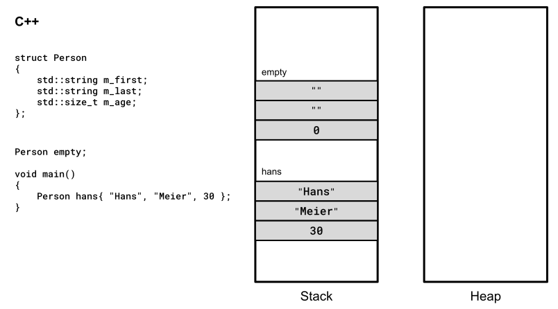
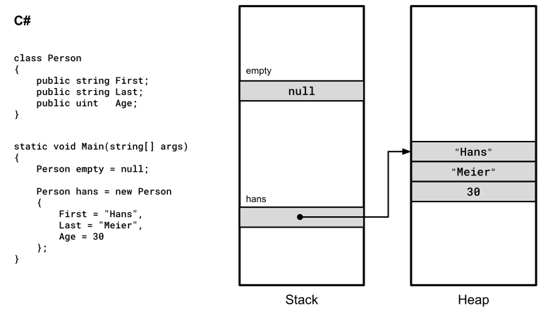
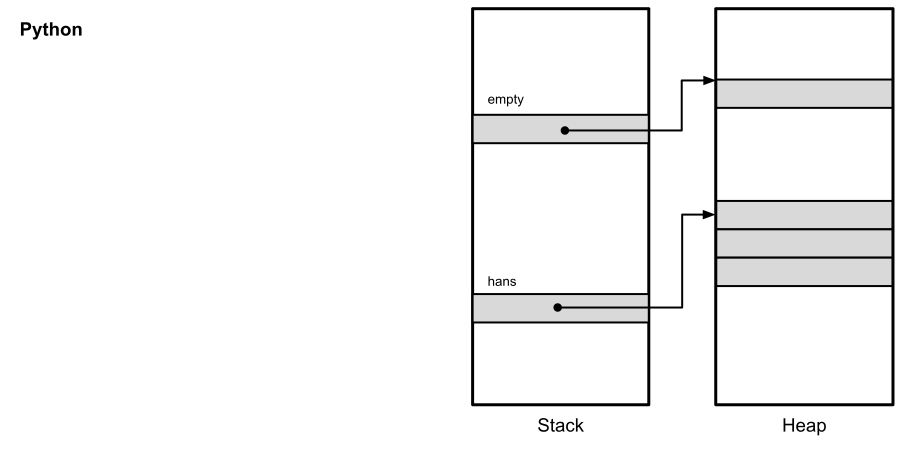
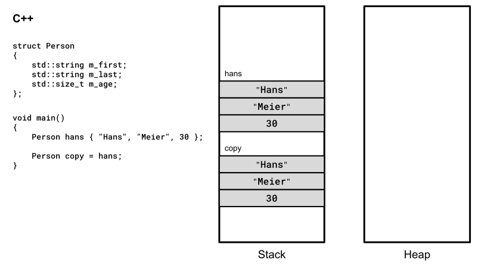
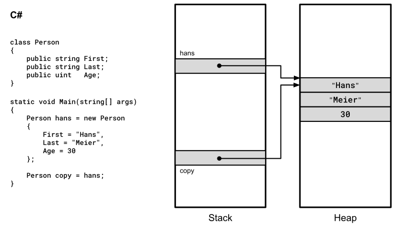
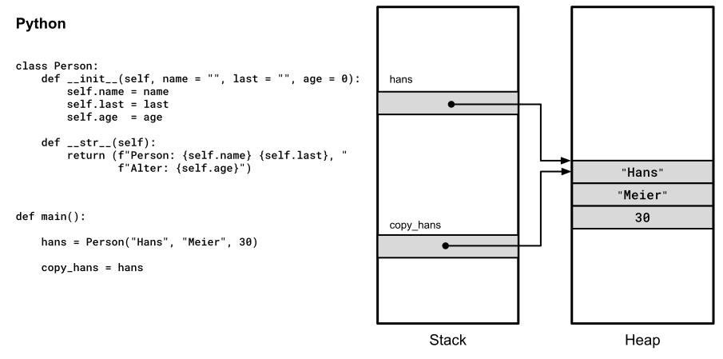
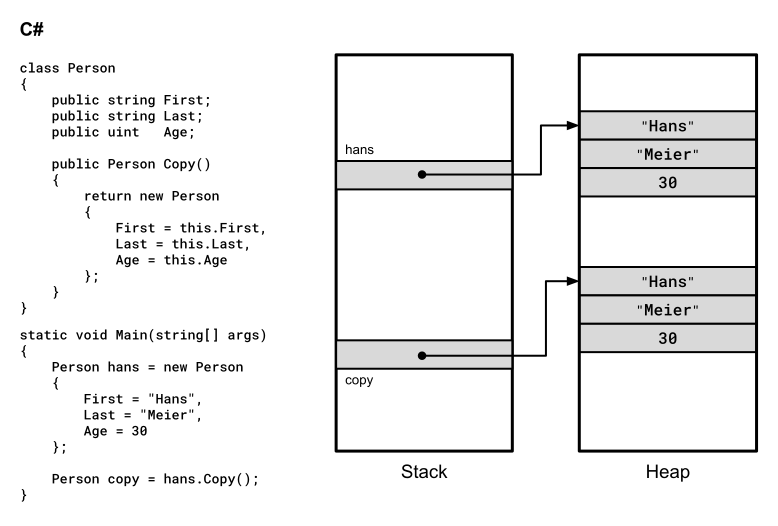
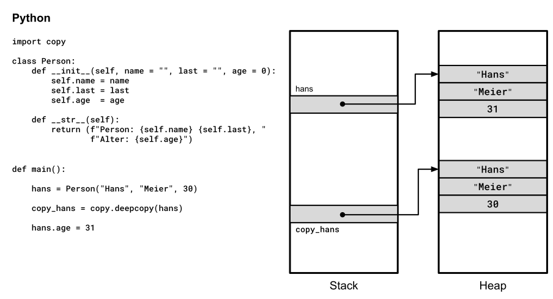
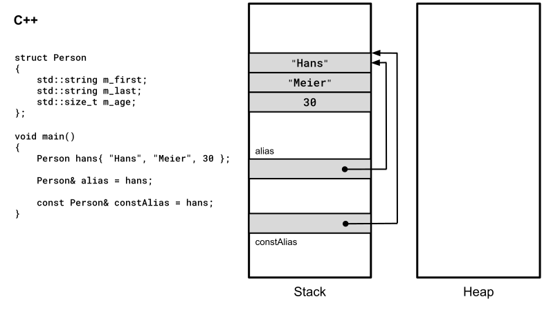
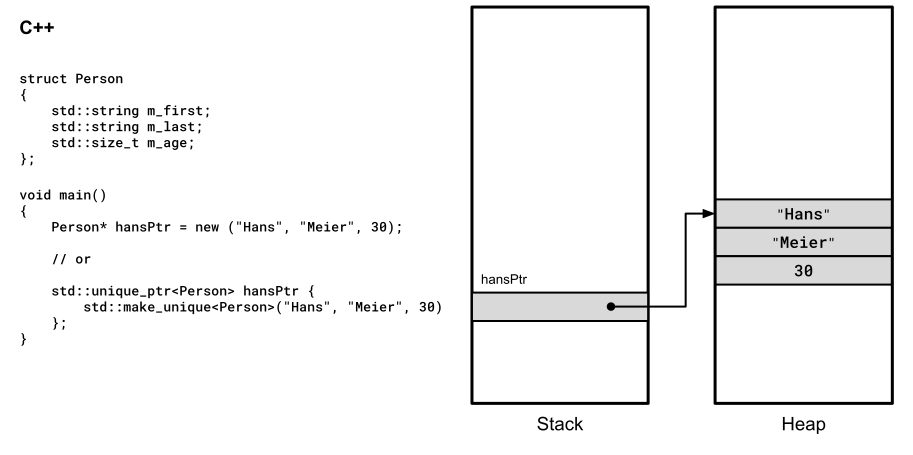

# Wertsemantik versus Referenzsemantik

[Zurück](../../Readme.md)

---

## Inhalt

  * [Allgemeines](#link1)
  * [Wertsemantik (*Value-based Semantics*)](#link2)
  * [Referenzsemantik (*Reference-based Semantics*)](#link3)
  * [Ein Vergleich auf einen Blick](#link4)
  * [Wertsemantik versus Referenzsemantik in Bildern](#link5)
    * [Objekte erzeugen](#link6)
    * [Objekte kopieren](#link7)
	* [Referenzsemantik in C++](#link8)

---

## Allgemeines <a name="link1"></a>

In einer Programmiersprache beschreiben die Begriff *Wertsemantik* und *Referenzsemantik*
(im engl. *Value-based*- und *Reference-based Semantics*) Vorgehensweisen,
wie Objekte gespeichert, kopiert und an Funktionen übergeben werden.

C++ unterstützt beide Arten dieser Semantiken,
standardmäßig wird die *Value-based Semantics* (Wertsemantik) eingesetzt.
Einer der vielen Gründe, warum C++ eine so vergleichsweise komplexe und deshalb schwer zu erlernende Programmiersprache ist,
hat eben damit zu tun, dass beide Arten dieser Semantiken vorhanden sind (siehe dazu auch *Tabelle* 1). 

| Programmiersprache | Wertsemantik | Referenzsemantik |
|:-|:-|:-|
| C++  | &#9989; | &#9989; |
| C#  | &#10060; (ausgenommen `struct`) | &#9989; |
| Java  | &#10060; | &#9989; |
| Python | &#10060; | &#9989; |

*Tabelle* 1: Wert- und Referenzsemantik von unterschiedlichen Programmiersprachen im Vergleich.

Viele andere Sprachen (wie C#, Java oder Python) unterstützen für Objekte nur die Referenzsemantik.

Da diese Sprachen zeitlich betrachtet nach C++ erfunden/konzipiert wurden, hat man versucht, einige der Erfahrungen
aus dem Sprachentwurf von C++ mit einzubringen. Eine dieser Konsequenzen dürfte sicherlich gewesen sein,
auf die Wertsemantik in C#/Java etc. zu verzichten, um die Komplexität der neu entwickelten Sprachen einfacher zu halten.

Von dieser strengen Regel gibt es Ausnahmen: Elementare Datentypen (`int`, `double`) liegen immer als Wert vor (auf dem Stack).
Ferner kann man in C# von der standardmäßig vorhandenen Referenzsemantik abweichen, wenn man Objekte mit dem Schlüsselwort `struct` definiert.
Auf diese Weise kommen sie auf dem Stack zu liegen.
Diese Vorgehensweise stellt im Großen und Ganzen aber eher eine Ausnahme in C#&ndash;Programmen dar.

---

## Wertsemantik (*Value-based Semantics*) <a name="link2"></a>

Hier steht der Inhalt (Wert) eines Objekts im Vordergrund, nicht seine Identität.

  * Kopierverhalten:<br />Bei einer Zuweisung (`a = b;`) wird eine unabhängige Kopie des Objekts erstellt.
    Änderungen an `a` beeinflussen `b` nicht.
  * Speicherung:<br />Objekte werden direkt (z. B. auf dem Stack oder im globalen Datensegment) gespeichert,
    was oft schnelleren Zugriff ermöglicht, da keine zusätzliche Indirektion über Pointer nötig ist.
    Der Inhalt (Wert) eines Objekts befindet sich bei Wertsemantik nicht auf dem Heap.
  * Standard in C++:<br />Alle elementaren Typen (`int`, `double`) und benutzerdefinierten Typen (`struct`, `class`) folgen standardmäßig diesem Prinzip.
  * Vorteile:<br />Höhere Sicherheit (direkter Zugriff über eine vorhandene Adresse/statisches Binden,
    keine Probleme mit ungültigen Adressen), bessere Performance durch Cache-Lokalität.

---

## Referenzsemantik (*Reference-based Semantics*) <a name="link3"></a>

Hier steht die Identität eines Objekts im Vordergrund. Variablen sind lediglich &bdquo;Labels&rdquo; oder &bdquo;Aliase&rdquo; für ein existierendes Objekt.

  * Kopierverhalten:<br />Bei einer Zuweisung (`a = b;`) wird lediglich die Adresse (Pointer/Referenz) kopiert.
    Mehrere Zeiger-/Referenzvariablen zeigen auf dasselbe physische Objekt im Speicher.
    Das Objekt selbst kann auf dem Heap, dem Stack oder im globalen Datensegment liegen.
    Objekte, die auf dem Heap liegen, sind ausschließlich über Zeiger (Pointer) erreichbar.
    Objekte, die auf dem Stack oder im globalen Datensegment liegen, können über Referenzen (Alias) und über Zeiger (Pointer) angesprochen werden.
    Die Schreibweise mit Referenzen führt zu leichter lesbarem Quellcode.
    Änderungen über eine Referenz oder einen Pointer sind für alle sichtbar.
  * Explizite Nutzung:<br />In C++ muss Referenzsemantik explizit durch die Verwendung von Pointern/Zeigern (`*`) oder durch Referenzen (`&`) erzwungen werden.
    Soll das Objekt auf dem Heap liegen, muss der entsprechende Speicher mit dem `new`-Operator reserviert und mit dem `delete`-Operator wieder freigegeben werden.
    Objekte auf dem Heap sind nur über Zeiger/Pointer erreichbar.
  * Vorteile:<br />Vermeidung teurer Kopien bei großen Objekten, Ermöglichung von Polymorphismus (dynamisches Binden). 


---

## Ein Vergleich auf einen Blick <a name="link4"></a>

Wertsemantik und Referenzsemantik im Vergleich:

| Merkmal | Wertsemantik | Referenzsemantik |
|:-|:-|:-|
| Zuweisung  | Erstellt eine neue, unabhängige Kopie. | Kopiert nur den Verweis auf das Original. Möchte man das Original kopieren, muss dies explizit veranlasst werden. |
| Identität  | Unwichtig: nur der Wert zählt.         | Zentral: Alias für dasselbe Objekt. |
| Effizienz  | Potenziell teurer durch Kopieraufwand. | Effizienter für große Datenmengen, da keine Kopien entstehen. |
| Sicherheit | Sicherer (kein unerwartetes Aliasing). | Risiko von ungültigen Zeigern/Adressen/Referenzen. |

*Tabelle* 2: Wert- und Referenzsemantik im Vergleich.

---

## Wertsemantik versus Referenzsemantik in Bildern <a name="link5"></a>

  * Wertsemantik in C++
    * Objekte erzeugen
    * Objekte kopieren
  * Referenzsemantik in C++
    * Mit Referenzen
    * Mit Adressen (Pointer)

Es werden Vergleiche mit C# und Python betrachtet.

---

### Objekte erzeugen <a name="link6"></a>

#### Wertsemantik in C++

Objekte können in C++ global oder lokal angelegt werden:



*Abbildung* 1: Wertsemantik in C++.


#### Referenzsemantik in C#

Objekte in C# liegen generall am Heap:



*Abbildung* 2: Referenzsemantik in C#.

#### Referenzsemantik in Python

Objekte in Python liegen ebenfalls ausnahmslos am Heap:



*Abbildung* 3: Referenzsemantik in Python.

Zwischen C# und Python gibt es kleine Unterschiede. So kennt Python keine *Null*-Referenzen wie im Sinne von C#.
Wenn in Python eine Variable auf &bdquo;nichts&rdquo; zeigen soll, weist man ihr das eingebaute Schlüsselwort `None` zu.
`None` ist ein vollwertiges Objekt vom Datentyp `NoneType` und liegt am Heap (*Singleton*).

---

### Objekte kopieren <a name="link7"></a>

#### Kopieren eines Objekts bei Wertsemantik

Beim Kopieren eines C++&ndash;Objekts entsteht eine echte Kopie.
Je nach Struktur des Objekts kann hierzu ein Kopierkonstruktor notwendig sein,
ein entsprechender Aufruf erfolgt implizit:



*Abbildung* 4: Kopieren eines Objekts bei Wertsemantik in C++.

#### Kopieren eines Objekts bei Referenzsemantik

Beim Kopieren eines C#&ndash; oder Python&ndash;Objekts wird die Referenz kopiert &ndash; das Objekt selbst bleibt davon unberührt:



*Abbildung* 5: Kopieren eines C#&ndash;Objekts bei Referenzsemantik in C#.



*Abbildung* 6: Kopieren eines Python&ndash;Objekts bei Referenzsemantik in Python.

#### Erstellen einer echten Kopie bei Referenzsemantik

Um in C# eine echte (tiefe) Kopie eines Objekts zu erstellen, muss dies mit einem expliziten Methodenaufruf erfolgen.



*Abbildung* 7: Erstellen einer echten Kopie bei Referenzsemantik in C#.

Um in Python eine echte (tiefe) Kopie eines Objekts zu erstellen,
verwendet man am besten das integrierte Modul `copy` sowie dessen Funktion `copy.deepcopy()`:



*Abbildung* 8: Erstellen einer echten Kopie bei Referenzsemantik in Python.

---

### Referenzsemantik in C++ <a name="link8"></a>

#### Referenzsemantik mit Referenzen

In C++ kann man zu existierenden Objekten eine Referenz definieren.
Die Referenz ist ein Alias &ndash; hinter dem Alias verbirgt sich eine Adresse und damit keine Kopie:



*Abbildung* 9: Referenzsemantik mit Referenzen.


#### Referenzsemantik mit Zeigern

Objekte in C++ können dynamisch sein:
Dazu sind in &bdquo;*Classic C++*&rdquo; die Operatoren `new` und `delete` zu verwenden,
in *Modern C++* die Smart Pointer Klassen `std::unique_ptr`, `std::shared_ptr` oder `std::weak_ptr`:



*Abbildung* 10: Referenzsemantik mit Zeigern.

Theoretisch ließen sich Objekte am Heap auch über Referenzen ansprechen, dies ist aber mehr als unüblich
und führt auf Grund der Lebensdauereinschränkungen von dynamischen Objekten eher zu Fehlern:

```cpp
01: std::unique_ptr<Person> hansPtr{
02:     std::make_unique<Person>("Hans", "Meier", 30)
03: };
04: 
05: Person& personRef = *hansPtr;
06: 
07: hansPtr->m_age++;
08: 
09: personRef.m_age++;
```

Die allgemeine Regel für Zeiger (Pointer) und Referenzen in C++ lautet:

  * Referenzen: Sie werden für lokale und globale Objekte verwendet.<br />
    Zum Beispiel bei der Parameterübergabe, um bei diesem Vorgang Kopien zu vermeiden.
	Zum Beispiel für globale Objekte, da diese für die gesamte Laufzeit des Programms existieren und es keinen Sinn ergibt,
	diese zu kopieren.<br />
	Lokale Objekte hingegen eignen sich nur für die Betrachtung von Zwischenergebnissen,
    da diese nach dem Verlassen des Unterprogramms (Methode, freie Funktion, Block) wieder zerstört werden.
	Daher macht es keinen Sinn, von einem lokalen Objekt eine Referenz zurückzugeben.

  * Zeiger: Sie werden für dynamische Objekte verwendet.<br />Ihr Speicherbedarf wird bei Bedarf reserviert und danach wieder freigegeben. 
    Dies ist der Hauptunterschied zu globalen oder lokalen Objekten.

---

[Zurück](../../Readme.md)

---
