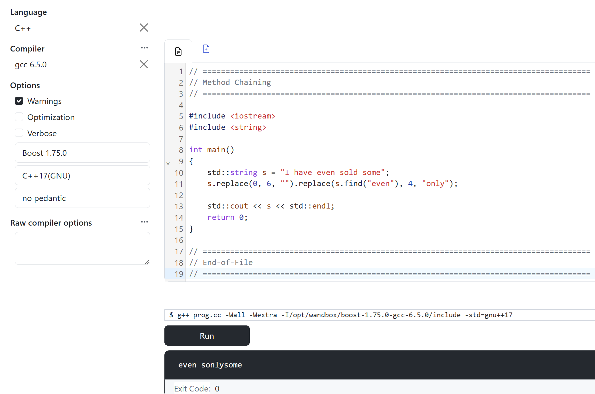
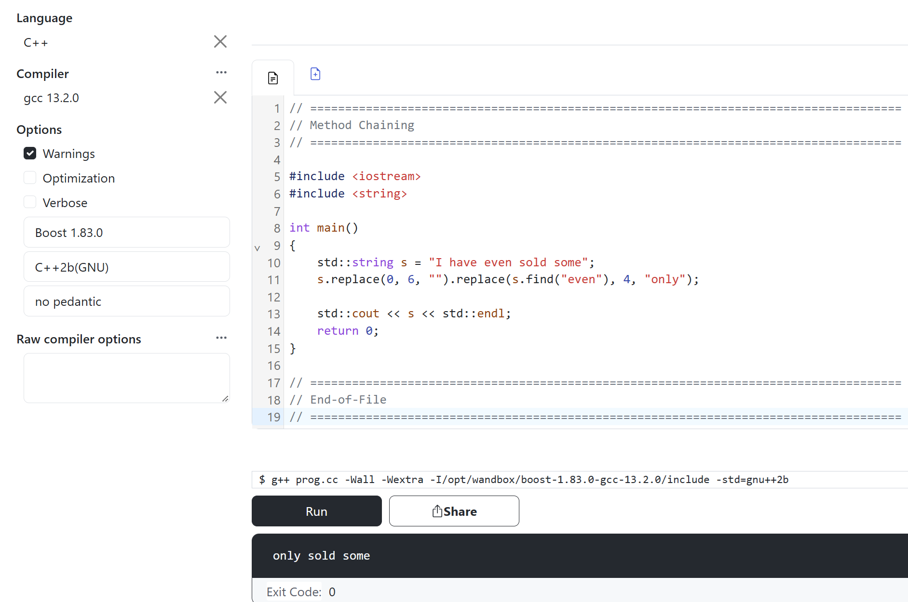

# From Legacy to Modernity

[Zurück](../../Readme.md)

---

[Quellcode](LegacyToModernity.cpp)

---

## Inhalt

  * [Die Grundregeln](#link1)
  * [Hoher Nutzen, geringes Risiko (häufig C++11 Erweiterungen)](#link2)
  * [Der größte Gewinn: Ownership und Ressourcenmanagement](#link3)
  * [Performanz and API Cleanliness](#link4)
  * [Die Standardbibliothek STL / Ersetzen von Eigenentwicklungen](#link5)
  * [Verschiedenes / Stolperfallen](#link6)

---

## Die Grundregeln <a name="link1"></a>

  * Modernisiere nur schrittweise:<br />
   Aber nur dort, wo es sich auszahlt &ndash; und niemals auf einen Schlag im Rahmen einer kompletten Neuentwicklung
  (sogenanntes &bdquo;*Big-Bang Rewrite*&rdquo;).

  * Erstelle Tests für den betroffenen Code, bevor irgendetwas geändert wird:<br />
  Sogenannte &bdquo;*Characterization Tests*&rdquo; (die das aktuelle Verhalten erfassen und festschreiben)
  sind wichtiger als jedes spezifische Sprachfeature.

  * Hebe den Standard schrittweise an:<br />
  Kompiliere den Code zunächst mit C++11, dann mit C++14, C++17 usw.
  Behebe bei jedem Schritt die auftretenden Warnungen.
  Ein direkter Sprung auf C++20 oder höher macht es schwieriger, Fehler ihren jeweiligen Ursachen zuzuordnen.

  * Nutze Werkzeuge:<br />
  `clang-tidy` bietet eine Reihe von &bdquo;modernize-*&rdquo;-Prüfungen
  (z. B. `modernize-use-override`, `modernize-use-nullptr`, `modernize-loop-convert`, `modernize-use-auto`, `modernize-make-unique` usw.),
  die den Großteil der mechanischen Arbeit sicher erledigen.

  * *Sanitizer* (ASan/UBSan):<br />
  Setze Sanitizer (ASan/UBSan) ein und verwende die Compiler-Flags `-Wall` sowie `-Wextra`,
  um Probleme aufzudecken, die im alten Code bisher unbemerkt blieben.

  * Ändere nur Code, an dem ohnehin gerade gearbeitet wird:<br />
  Modernisiere keine stabilen, unangetasteten Module allein aus stilistischen Gründen.

## Hoher Nutzen, geringes Risiko (häufig C++11 Erweiterungen)  <a name="link2"></a>

#### 1. Versehentliches Kopieren statt Gebrauch einer Referenz

```cpp
01: class Person
02: {
03: private:
04:     std::string m_name;
05: 
06: public:
07:     // c'tor
08:     Person(const std::string& name) : m_name(name) {}
09: 
10:     // setter
11:     void setName(std::string name) { m_name = name; }
15: };
```

Der *setter* kann besser geschrieben werden, es sollte die überflüssige Kopie vermieden werden:

```cpp
void setName(const std::string& name) { m_name = name; }
```

#### 2. Versehentliches Kopieren statt Gebrauch einer Referenz &ndash; bei Rückgabe eines Werts

```cpp
01: class Person
02: {
03: private:
04:     std::string m_name;
05: 
06: public:
07:     // c'tor
08:     Person(const std::string& name) : m_name(name) {}
12: 
13:     // getter
14:     std::string getName() { return m_name; }
15: };
```

Der *getter* kann besser geschrieben werden:

```cpp
const std::string& getName() { return m_name; }
```

Diese Anregung ist mit einer gewissen Vorsicht zu sehen:
Die resultierende Referenz ist nur so lange gültig, wie das beteiligte Objekt noch nicht zerstört wurde.

#### 3. `nullptr` statt `NULL` / `0`

Das Kernproblem: `NULL` ist eine ganzzahlige Konstante.

In C++98 ist `NULL` als `0` (bzw. `0L` oder &ndash; bei GCC &ndash; als `__null`) definiert,
es handelt sich also um eine Ganzzahlkonstante, nicht um einen Zeiger. Dies führt zu mehreren konkreten Problemen.

1. Bei der &bdquo;*Overload Resolution*&rdquo; wird die falsche Funktion gewählt.

```cpp
01: void log(int code) {}
02: void log(const char* msg) {}
03: 
04: log(NULL);     // calls log(int)! (or is ambiguous, depending on the compiler)
05: log(nullptr);  // calls log(const char*), as intended
```

Bei `NULL` erhält man &ndash; ohne dass dies explizit gemeldet wird &ndash; entweder die Überladung für Ganzzahlen oder einen Fehler
wegen eines &bdquo;mehrdeutigen Aufrufs&rdquo; (&bdquo;*ambiguous call*&rdquo;).

`nullptr` hingegen besitzt einen eigenen Typ,
`std::nullptr_t`, der zwar in jeden Zeigertyp konvertiert werden kann, niemals jedoch in eine Ganzzahl.

2. *Template Forwarding* schlägt fehlt

```cpp
01: void takesPointer(int* ptr) {}
02: 
03: template <typename T>
04: void wrap(T arg) { takesPointer(arg); }
05: 
08: wrap(0);           // T = int; int does NOT convert to a pointer, compile error
09: wrap(NULL);        // same problem, compile error
10: wrap(nullptr);     // T = nullptr_t; converts to any pointer, works
```

#### 4. Schlüsselwort `override`<br />

Mit dem Schlüsselwort `override` erkennt man stillschweigende Signaturkonflikte, die Verwendung des Schlüsselworts ist kostenlos.

Deklariert man eine Methode mit dem Schlüsselwort `override`, drückt man die Absicht aus,
sie zu überschreiben. 
Daher ist es sinnvoll, `override` an der Stelle anzugeben,
an der man diese Absicht hat. Dies kann und sollte man dann den Übersetzer auch überprüfen lassen,
nämlich die Absicht, diese Methode zu überschreiben:

> **The more things you check at compile time the fewer runtime bugs you have.**

Eine derartige Deklaration reicht dann auch aus, um zu überprüfen,
ob die Methode ursprünglich (in einer der Basisklassen) als `virtual` deklariert wurde
und ob man in der abgeleiteten Klasse die Signatur richtig verwendet hat.

*Beispiel*:

```cpp
01: class Base
02: {
03: public:
04:     virtual void func() { std::println("In base class"); }
05: };
06: 
07: class Derived : public Base
08: {
09: public:
10:     void func(int a)
11:     {
12:         std::println("In derived class");
13:     }
14: };
15: 
16: void test()
17: {
18:     Base base;
19:     Derived derived;
20:     std::println("Compiles successfully");
21: 
22:     Base* bp;
23:     bp = &derived;
24:     bp->func();
25: }
```

*Frage*:<br />
Welche Ausgabe erwarten Sie in der Konsole?

*Ausgabe*:

```
Compiles successfully
In base class
```

#### 5. Bereichsbasierte `for`-Schleife und Verwendung von `auto` für Iteratoren-Boilerplate Code

```cpp
01: // C++98
02: for (std::vector<Order>::const_iterator it = orders.begin(); it != orders.end(); ++it)
03:     total += it->price();
04: 
05: // C++11
06: for (const Order& o : orders)
07:     total += o.price();
```

Die zweite Version lautet &bdquo;für jede Bestellung&rdquo; &ndash; ohne expliziten Gebrauch eines Iteratortyps,
ohne `begin()`/`end()` und ohne `++it`, bei dem man Fehler machen kann.

Herkömmliche Schleifen lassen Fehler zu, die der Compiler nicht erkennt:

  * Vergleiche mit dem `end()` eines anderen Containers (*Copy-and-Paste*-Fehler).
  * `it++` statt `++it` (oder das Vergessen des Inkrements).
  * die Verwendung eines `iterator`-Objekts anstelle eines `const_iterator`-Objekts (oder umgekehrt).
  * &bdquo;Off-by-one&rdquo;-Fehler bei indexbasierten Schleifen (z. B. `i <= v.size()`).

Die bereichsbasierte `for`-Schleife schließt all diese Fehler konstruktionsbedingt aus.

#### 6. Verwendung von `auto`: Refactoring wird einfacher

Wenn jemand `std::vector<Person>` in `std::list<Person>` oder `std::deque<Person>` ändert,
müssen alle explizit ausgeschriebenen Anweisungen mit

`std::vector<Person>::const_iterator`-Variablen

angepasst werden:

```cpp
01: std::vector<Person> persons;   // add comment ...
02: // std::list<Person> persons;  // ... and remove comment
03: 
04: std::vector<Person>::const_iterator it = persons.cbegin(); // iterator type must be manually adjusted
05: 
06: auto it2 = persons.cbegin();                               // iterator type is deducted automatically - at compile time
```

Bei einer &bdquo;Range-based for&rdquo;-Schleife oder der Verwendung von `auto` spielt das hingegen keine Rolle.

Dasselbe gilt für lange Template-Typen wie `std::map<std::string, std::vector<int>>::const_iterator`:

`auto` übernimmt dies, ohne dass man den Typ selbst ausschreiben muss.

##### Man beachte, was man **nicht** gewinnt

  * Kein Performance-Unterschied. Es wird im Wesentlichen in denselben Code übersetzt wie eine Schleife mit Iteratoren.
  * Keine Verhaltensänderung (sofern die Umstellung korrekt durchgeführt wird).
  * Keine Fehlerbehebungen in bereits funktionierendem Code. Schleifen, die seit Jahren einwandfrei funktionieren, werden nicht plötzlich fehlerhaft.

##### Man beachte, wo Probleme auftreten können

  * Versehentliche Kopien: `for (auto o : orders)` kopiert jedes Element. Verwende stattdessen `const auto&` (oder `auto&`), falls man das Element ändern möchte.
  * Schleifen, die den Iterator selbst verwenden (etwa zum Löschen von Elementen, für `std::distance` oder den Zugriff auf das vorherige bzw. nächste Element), lassen sich nicht einfach umstellen.
  * Wird der Container innerhalb der Schleife verändert, werden &ndash; genau wie zuvor &ndash; die Iteratoren ungültig; eine bereichsbasierte `for`-Schleife (*Range-based for loop*) bietet in diesem Fall auch keinen Schutz.


#### 7. Enum-Klassen statt einfacher Enums

Unterschiede im Gültigkeitsbereich, keine implizite `int`-Konvertierung:

```cpp
01: // 1. the problem with classic enums (unscoped enums)
02: enum CarColor { Red, Blue, Green };
03: // enum WineColor { Red, WHITE }; // ERROR: "Red" conflicts with CarColor::Red!
04: 
05: // 2. the solution: Enum classes (scoped enums)
06: enum class TrafficLightPhase { Red, Yellow, Green }; // "Red" and "Green" are safely encapsulated here
07: 
08: enum class SensorStatus { Ok, Error, Red };          // No name conflict with TrafficLightPhase::Red!
09: 
10: static void legacy_enums() {
11: 
12:     // --- DIFFERENCE 1: Scope ---
13:     // with classic enums, the values ??are exported into the surrounding scope:
14:     int myColor = Red;
15: 
16:     // with enum class, the name of the enumeration must be prefixed:
17:     TrafficLightPhase light = TrafficLightPhase::Red;
18: 
19:     SensorStatus sensor = SensorStatus::Red;   // cleanly separated! 
20: 
21:     // --- DIFFERENCE 2: Implicit int conversion ---
22:     // classic enums implicitly convert to int (error-prone!):
23:     if (myColor == 0) {
24:         std::println("This works because Red implicitly becomes 0.");
25:     }
26: 
27:     // enum classes completely prevent this implicit conversion:
28:     // if (light == 0) { } // COMPILER ERROR: No implicit conversion! 
29: 
30:     // if you absolutely need the integer value,
31:     // you must request it explicitly (using static_cast):
32:     if (static_cast<int>(light) == 0) {
33:         std::println("Explicit cast works: TrafficLightPhase::Red is {}", static_cast<int>(light));
34:     }
35: }
```

#### 8. `= delete` an Stelle des Tricks mit &bdquo;privatem Kopierkonstruktor&rdquo;

Gegen private Konstruktoren spricht zunächst einmal nichts, wenn sie ihren eigentlichen Zweck erfüllen &ndash; wie
etwa beim *Singleton*-Pattern oder bei *Factory*-Methoden, wo die Instanziierung bewusst kontrolliert werden soll.

Wenn es aber rein darum geht, das Kopieren oder Verschieben eines Objekts zu verhindern,
ist der alte Trick mit dem privaten, undefinierten Kopierkonstruktor (aus C++ 98&ndash;Zeiten) heute veraltet.
Seit C++ 11 ist `= delete` der Standard.

| Kriterium | Alter C++98 Trick (`private` | Moderner C++11 Weg (`= delete`) | 
|:- |:-|:-|
| Fehlermeldung | Spät und kryptisch. Oft erst beim Linken, falls innerhalb der Klasse kopiert wird. | Sofort und klar verständlich. Fehlermeldung direkt beim Kompilieren mit exakter Zeilenangabe. |
| Lesbarkeit (Intention) | Der Entwickler muss raten, ob das Absicht ist oder noch implementiert wird. | Explizit. Drückt die Design-Entscheidung sofort unmissverständlich aus. |

*Tabelle* 1: Vergleich von privatem Kopierkonstruktor und `= delete`.


## Der größte Gewinn: Ownership und Ressourcenmanagement <a name="link3"></a>

C++ 98&ndash;Code enthält typischerweise direkte `new`/`delete`-Aufrufe, manuelle Ressourcenbereinigung sowie `std::auto_ptr`.

Hier verbergen sich die meisten echten Fehler (Leaks, Double-Frees, Lücken in der Exception-Sicherheit).
Daher ist dies die lohnendste Änderung, erfordert aber auch die größte Sorgfalt.
Gehen Sie dabei modulweise vor und setzen Sie Tests ein.

#### 1. Ersetze `std::auto_ptr` durch `std::unique_ptr`

Da `std::auto_ptr` in C++17 entfernt wurde, ist dieser Schritt langfristig zwingend erforderlich.

#### 2. Klassen `std::unique_ptr` und `std::shared_ptr`

Für besitzende (&bdquo;owning&rdquo;) Rohzeiger gilt: Verwende `std::unique_ptr` (bei exklusivem Besitz) oder
`std::shared_ptr` (nur wenn der Besitz tatsächlich geteilt wird).

Erstelle diese Objekte mittels `std::make_unique` (ab C++14) oder `std::make_shared`.

#### 3. Nicht-besitzende (&bdquo;non-owning&rdquo;) Rohzeiger können beibehalten werden

Es ist nicht erforderlich, jeden Zeiger in einen Smart Pointer umzuwandeln &ndash; dies wäre eine unnötige Überkorrektur.

#### 4. Nutze RAII-Wrapper für Ressourcen wie Dateien, Locks oder Handles

Nutze RAII-Wrapper-Klassen wie z. B. `std::lock_guard` / `std::scoped_lock`, `std::fstream` oder `std::unique_ptr` mit benutzerdefinierten &bdquo;Deletern&rdquo;.

#### 5. Verwenden Sie Container bzw. die STL anstelle von Eigenentwicklungen

Man sollte die Container der C++ Standard Template Library (STL) im Gegensatz zu Eigenentwicklungen einsetzen,
weil sie hochgradig optimiert, fehlerfrei getestet und der gemeinsame Standard in der C++-Entwicklung sind.

Das Rad neu zu erfinden, kostet in diesem Fall fast immer Performance und Stabilität.

##### 1. Maximale Performance (Effizienz)

  * Von Experten optimiert: Die STL-Container wurden über Jahrzehnte von den weltweit besten C++-Entwicklern optimiert.
  * Compiler-Optimierung: Moderne Compiler kennen die STL in- und auswendig und können den generierten Maschinencode extrem effizient optimieren (z. B. durch Inlining).
  * Speichereffizienz: Klassen wie `std::vector` minimieren den Overhead bei der Speicherallokation durch clevere Wachstumsstrategien.

##### 2. Zuverlässigkeit und Fehlerfreiheit (Robustheit)

  * Milliardenfach bewährt: STL-Container sind im produktiven Einsatz bei Google, Microsoft, in Gaming-Engines und Raumfahrtsystemen.
	Sie enthalten keine versteckten Speicherlecks oder Edge-Case-Bugs mehr.
  * Typsicherheit: Durch C++ **Templates** arbeitet die STL komplett typsicher zur Kompilierzeit, ohne Performance-Verlust.

##### 3. Standardisierung und Lesbarkeit (Wartbarkeit)

  * Gemeinsame Sprache: Jeder C++-Entwickler weltweit versteht sofort, was ein `std::vector` oder eine `std::unordered_map` macht.
	Bei einer Eigenentwicklung wie `MyCustomList` muss sich jeder neue Entwickler erst durch den Quellcode wühlen.
  * Zukunftssicherheit: Die STL wird mit jedem neuen C++-Standard (C++20, C++23, C++26) automatisch weiterentwickelt,
	sicherer gemacht und um moderne Features (wie *Ranges*) erweitert.

##### 4. Das STL-Ökosystem (Interoperabilität)

  * Nahtloses Zusammenspiel: STL-Container sind perfekt auf die Algorithmen der STL (`<algorithm>`) abgestimmt.
    Man kann eine `std::unordered_set` ohne Anpassung mit `std::find`, `std::copy` oder Sortieralgorithmen kombinieren.

##### 5. Produktivität (*Time-to-Market*)

  * Kein Zeitverlust: Das Schreiben einer eigenen, absolut sicheren Hashtabelle inklusive Memory-Management, Iterator-Support und Thread-Safety-Garantien dauert Tage oder Wochen.
	Die STL liefert das fehlerfrei in einer Zeile Code.

*Tabelle* 2 gibt einen Überblick über gängige Datenstrukturen aus der Informatik und ihrem Pendant in der STL:

| Datenstruktur | STL-Klasse | 
|:- |:-|
| Flexibel langes Feld | &rarr; Klasse `std::vector<>` |  
| Fixed-Size Array | &rarr; Klasse `std::array<>` | 
| Einfach verkettete Liste | &rarr; Klasse `std::forward_list<>` |
| Doppelt verkettete Liste | &rarr; Klasse `std::list<>` | 
| Hash Tabelle (unsortiert, Schlüssel-Wert Paare) | &rarr; Klasse `std::unordered_map<>` |
| Hash Tabelle (unsortiert, Element ist gleich Schlüssel) | &rarr; Klasse `std::unordered_set<>` |
| Suchbaum (meist Rot-Schwarz-Baum, Schlüssel-Wert Paare) | &rarr; Klasse `std::map<>` |
| Menge (Element ist gleich Schlüssel) | &rarr; Klasse `std::set<>` |
| Stapel (Stack, Last-In, First-Out) | &rarr; Klasse `std::stack<>` |
| Warteschlange (Queue, First-In, First-Out) | &rarr; Klasse `std::queue<>` |

*Tabelle* 2: Allgemeine Datenstruktur und korrespondierende STL-Klasse.


## Performanz and API Cleanliness <a name="link4"></a>

#### 1. Move-Semantik (RValue-Referenzen)

  * Das Weiterreichen großer Objekte per Wert wird effizienter.

  * Füge Move-Konstruktoren/Zuweisungen hinzu, wenn Klassen Ressourcen besitzen &ndash; folge nach Möglichkeit der &bdquo;*Rule of Zero*&rdquo;:
  Wenn Member sich selbst verwalten, benötigt man keine speziellen Member.

#### 2. `emplace_back` / `emplace`

Verwende `emplace_back` / `emplace` anstelle der Erstellung eines temporären Objekts und dessen Zuweisung.

#### 3. `std::unordered_map` / `std::unordered_set`

Verwende `std::unordered_map` bzw. `unordered_set` an Stelle von `std::map` bzw. `set`, wenn keine Reihenfolge (Sortierung) erforderlich ist.

#### 4. Einheitliche Initialisierung

Einheitliche Initialisierung (&bdquo;*Uniform Initialization*&rdquo; mit `{}`) und Initialisierungslisten für eine übersichtlichere Konstruktion.

Beachte auf den Fehler `std::vector<int>{3, 4}` vs. `std::vector<int>(3, 4)` und verringere Konvertierungen, die nun Fehler verursachen.

#### 5. Vererbung von Konstruktoren

Vererbe Konstruktoren, um doppelten Initialisierungscode zu vermeiden.

*Beispiel*:

```cpp
01: class Base {
02: public:
03:     Base(int id) : m_id(id) {}
04:     Base(int id, const std::string& name) : m_id(id), m_name(name) {}
05: 
06: protected:
07:     int         m_id;
08:     std::string m_name;
09: };
10: 
11: class Derived : public Base {
12: public:
13:     using Base::Base;       // inherits Base(int) and Base(int, const std::string&)
14:
15: private:
16:     int m_extra = 0;        // default member initializer, important
17: };
```

*Einige Hinweise*:

  * Neue Member der abgeleiteten Klasse (`Derived`) werden nicht durch die geerbten Konstruktoren initialisiert &ndash; abgesehen
   von ihren jeweiligen Standard-Member-Initialisierern. Deshalb ist `m_extra = 0` wichtig;
   ohne diese Angabe bliebe `m_extra` (*Built-in Type*) uninitialisiert.

  * Standard-, Kopier- und Verschiebekonstruktoren der Basisklasse werden nicht vererbt
   (die abgeleitete Klasse erhält stattdessen ihre eigenen, implizit generierten Varianten).

  * Deklariert die abgeleitete Klasse einen Konstruktor mit derselben Signatur wie ein geerbter Konstruktor,
   so verdeckt die eigene Version den geerbten Konstruktor.

  * Die Zugriffsberechtigung entspricht der in der Basisklasse: Ein geerbter Konstruktor besitzt denselben Zugriffsschutz wie in der Basisklasse.


#### 6. Standard-Member-Initialisierer

Verwende Standard-Member-Initialisierer (`int count = 0;`), um Konstruktoren zu vereinfachen.


## Die Standardbibliothek STL / Ersetzen von Eigenentwicklungen <a name="link5"></a>

#### 1. Lambdas anstelle von Funktor-Klassen oder `std::bind1st`/`std::bind2nd`
  Sie sind im Zusammenhang mit `std::sort`, `std::find_if` usw. deutlich besser lesbar.

#### 2. `std::function<>` anstelle von rohen Funktionszeigern in Kombination mit `void*`-Benutzerdaten.

#### 3. `<chrono>`, `<thread>`, `<mutex>`, `<atomic>`, `<future>` anstelle von plattformspezifischem Code (wie `pthread` oder Win32-APIs).
  Dies bedeutet oft einen erheblichen Gewinn an Portabilität.

#### 4. `<random>` anstelle von `rand()`.

#### 5. `std::string_view` (C++17) für schreibgeschützte / konstante Zeichenketten.

```cpp
std::string s = "I'm more than 15 chars long - and reside on the heap";
std::string_view s = "I'm more than 15 chars long - and reside not the heap";
```

`std::string_view` Objekte liegen nicht auf dem Heap. Damit entfallen auf Aufrufe in die dynamische Speicherverwaltung (`new`/`delete`),
der &ndash; allerdings ausschließlich lesende &ndash; Zugriff ist schneller und manche Operationen (z. B. `substr`) sind ebenfalls erheblich performanter.


#### 6. `std::initializer_list` für schnellere Übergabe von Werten

```cpp
01: int adder(std::initializer_list<int> list)
02: {
03:     return std::accumulate(list.begin(), list.end(), 0);
04: }
05: 
06: int adder(const std::vector<int>& list)
07: {
08:     return std::accumulate(list.begin(), list.end(), 0);
09: }
10: 
11: void test()
12: {
13:     int sum = adder({ 1, 2, 3, 4, 5 });
14:     std::println("{}", sum);
15: }
```

Die leichtgewichtige Containerklasse `std::initializer_list` wurde der Klassenbibliothek hinzugefügt,
um die Übergabe einer Vektoren-ähnlichen Datenstruktur, die ihre Werte auf den Heap kopiert und dort verwaltet,
auch ohne Heap zu ermöglichen.

*Vergleich*: 

Übergabe von Werten mit Klasse `std::vector`: Konzeptionell umfasst dies

  * Das Erstellen eines `std::vector`-Objekts.
  * Das Zuweisen von Speicher (`new`) für dessen Elemente, üblicherweise auf dem Heap.
  * Das Initialisieren dieses Speicherbereichs mit den Parametern der Funktion.
  * Das Übergeben einer Referenz, die auf das temporäre `std::vector`-Objekt verweist.
  * Aufruf der Zielfunktion.
  * Das Summieren der Elemente mit Hilfe zweier Iteratoren-Objekte, die das Vektoren-Objekt zur Verfügung stellt.
  * Das Zerstören des temporären `std::vector`-Objekts und die Freigabe des Heap-Speichers.
  * Rückgabe des Ergebnisses

Übergabe von Werten mit Klasse `std::initializer_list`: Konzeptionell umfasst dies

  * Ablegen der Parameter auf dem Stack (also kein Zugriff auf den Heap).
  * Übergabe zweier Iteratoren-Objekte (Adressen), die auf das erste und das letzte Element auf dem Stack verweisen.
  * Aufruf der Zielfunktion.
  * Das Summieren der Elemente mit Hilfe der zwei Iteratoren-Objekte, die das `std::initializer_list`-Objekt zur Verfügung stellt.
  * Rückgabe des Ergebnisses


#### 6. `std::optional` als Ersatz für Sentinel-Werte.

#### 7. `std::variant` als Ersatz für getaggte Unions.

#### 8. `std::any` als Ersatz für `void*`.

#### 9. `std::filesystem` (C++17) anstelle von selbst implementierter Dateisystembehandlung.

#### 10. Strukturierte Bindungen (*Structured Binding*) (C++17) für Paare, Tupel oder die Iteration über Maps.

#### 11. `[[nodiscard]]`, `[[maybe_unused]]` und `[[fallthrough]]` zur selbsterklärenden Kennzeichnung der Absicht.

#### 12. `std::expected` (C++23) zur Fehlerbehandlung ohne Exceptions.

---

## Verschiedenes / Stolperfallen <a name="link6"></a>

#### 1. Verkettung von Methodenaufrufen (geändert in C++17)

Der Umstieg auf C++11+ verändert manchmal die Semantik eines Programms, also einfacher formuliert:
Ein C++11 Programm erzielt andere Resultate als dasselbe Programm (derselbe Quellcode) ausgeführt mit einem C98 Compiler.

*Beispiel*:

```cpp
std::string s = "I have even sold some";
s.replace(0, 6, "").replace(s.find("even"), 4, "only");
```

Es ist kaum zu glauben, aber: Je nach benutzter C++ Version gibt es hier unterschiedliche Ergebnisse:

In C++ ist die Reihenfolge, in der Teilausdrücke innerhalb einer Zeile ausgewertet werden,
nicht immer strikt von links nach rechts vorgegeben.
Das Problem liegt hier konkret beim Aufruf von `s.find("even")`.

#### Warum gibt es mehrere Möglichkeiten?

Schauen wir uns die zweite Zeile genau an. Sie besteht aus zwei verketteten `.replace()`-Aufrufen:

```cpp
s.replace(0, 6, "").replace(s.find("even"), 4, "only");
// \_____________/         \_____________/
//    Aufruf 1                Aufruf 2
```

Damit der zweite `replace`-Aufruf ausgeführt werden kann, muss der Compiler zuerst seine Argumente auswerten.
Eines dieser Argumente ist `s.find("even")`.
Die Kernfrage ist: Wann wird `s.find("even")` ausgeführt? Vor oder nach dem ersten `.replace()`?

##### Möglichkeit A: `find` wird zuerst ausgeführt (ältere C++ Standards)

1. Der Compiler wertet `s.find("even")` im ursprünglichen String `"I have even sold some"` aus. Das Wort `"even"` startet hier bei Index 7.
2. Jetzt wird der erste Tausch ausgeführt: `s.replace(0, 6, "")`. Dadurch werden die ersten 6 Zeichen (`"I have"`) gelöscht. Der String ist nun: `" even sold some"`.
3. Nun wird der zweite Tausch mit dem vorher gemerkten Index (7) ausgeführt. Im neuen, kürzeren String ist Index 7 aber die Stelle hinter `"even"`.
   Das Ergebnis wird fehlerhaft, wie in unserem Fall (`"even sonlysome"`, siehe *Abbildung* 1) oder könnte auch zu einem Absturz führen.



*Abbildung* 1: Verkettung von Methodenaufrufen &ndash; hier: ältere C++ Standards.

##### Möglichkeit B: Ausführung von links nach rechts (C++17 und neuere C++ Standards)

Seit dem Standard C++17 wurde die Reihenfolge für verkettete Funktionsaufrufe (sogenanntes *Method Chaining*) strikt geregelt.
Es gilt: Alles auf der linken Seite einer Kette wird garantiert vor der rechten Seite ausgewertet.

1. Zuerst wird der erste Tausch ausgeführt: `s.replace(0, 6, "")`. Der String wird zu `" even sold some"`.
2. Erst danach wird das Argument für den zweiten Tausch ausgewertet: `s.find("even")`. Im neuen String `" even sold some"` liegt `"even"` nun bei Index 1.
3. Der zweite Tausch nutzt Index 1 und ersetzt `"even"` durch `"only"`, das Ergebnis lautet nun `"only sold some"` (*Abbildung* 2).



*Abbildung* 2: Verkettung von Methodenaufrufen ab C++17.

##### Fazit

  * Vor C++17 kann `s.find("even")` bereits ausgewertet werden, bevor der erste `replace`-Aufruf ausgeführt wird,
  was dazu führt, dass eine veraltete Position ermittelt wird.

  * Ab C++17 ist festgelegt, dass der Objektausdruck (`s.replace(...)`) vor den Argumenten des nachfolgenden Aufrufs ausgewertet wird.
  Dadurch sieht `find` den bereits modifizierten String.


#### 2. Ist Move-Semantik mein neuer Freund?

Ich möchte, um Laufzeit einzusparen, die eine oder andere überflüssige Kopier-Operation in meinem Programm zu Gunsten einer Verschiebe-Operation 
austauschen. Gibt es hier etwas zu beachten?

##### Nebenwirkungen / Seiteneffekte in Kopier-Konstruktoren treten nicht mehr auf

Wenn ein Kopierkonstruktor mehr tut als nur zu kopieren (Instanzen zählen, protokollieren, das Objekt registrieren, eine Versionsnummer erhöhen),
wird dieser Code nicht ausgeführt, sobald stattdessen eine Verschiebung ausgewählt wird:

```cpp
01: struct Handle {
02:     static int copies;
03:     Handle(const Handle&) { ++copies; }   // legacy: used as a statistic
04:     // ...
05: };
```

*Bemerkung*:<br />
Beachten Sie, dass in C++98 in Code mit einem vom Benutzer deklarierten Kopierkonstruktor
keine implizite Verschiebung generiert wird.
Dies funktioniert nur dann, wenn Sie `= default` hinzufügen.

#### 3. Standardmäßig generierte (&bdquo;defaulted&rdquo;) Move-Operationen arbeiten elementweise mit flacher Kopie

Bei Verwendung der standardmäßig generierten (&bdquo;*defaulted*&rdquo;) Move-Operation
werden rohe Zeiger einfach kopiert:

```cpp
01: class Buffer {
02: public:
03:     Buffer() { m_data = new char [5] {}; }
04:     Buffer(Buffer&&) = default;              // looks harmless
05:     ~Buffer() { delete[] m_data; }
06: private:
07:     char* m_data;
08: };
```

Die standardmäßig generierte Move-Operation kopiert den Zeiger,
ohne den Zeiger im Quellobjekt auf `nullptr` zu setzen.
Beide Objekte besitzen nun denselben Speicherbereich, was zu einem &bdquo;Double Free&rdquo;-Fehler führt.

Ein manuell implementierter Move-Konstruktor muss den Zeiger des Quellobjekts zurücksetzen.
Dies ist eine typische Falle, wenn für Klassen, die Ressourcen manuell verwalten, die Move-Operationen mittels `= default` definiert werden.

#### 4. Das umgekehrte Problem: Objekte werden nicht verschoben, sondern kopiert

In manchen Situationen kommen Kopien stillschweigend zum Einsatz, obwohl man ein
Verschieben erwarten würde.

Es geht hier aber weniger um Fehler als vielmehr um Beeinträchtigungen bzgl. der Performance.

##### `std::move` auf einem `const`-Objekt

In diesem Fall bindet die Anweisung an den Kopierkonstruktor, sodass eine Kopie erstellt wird und ein trügerisches Gefühl von Effizienz entsteht. 

```cpp
01: struct Tracer {
02: 
03:     std::string name;
04: 
05:     Tracer(std::string n) : name{ std::move(n) } {}
06: 
07:     Tracer(const Tracer& other) : name(other.name) {
08:         std::println("copy {}", name);
09:     }
10: 
11:     Tracer(Tracer&& other) noexcept : name{ std::move(other.name) } {
12:         std::println("move");
13:     }
14: };
15: 
16: void test()
17: {
18:     Tracer a{ "one" };
19:     Tracer b = std::move(a);        // prints "move"
20: 
21:     const Tracer c{ "two" };
22:     Tracer d = std::move(c);        // prints "copy two"
23: }
```

Noch ein zweites Beispiel: Eine etwas realistischere Version dieser Beobachtung:


```cpp
01: std::vector<std::string> members;
02: 
03: void store(const std::string& s) {
04:     members.push_back(std::move(s));   // looks efficient, actually copies
05: }
```


##### `std::move` im Zusammenspiel mit `return` 

Eine Anweisung der Gestalt

```cpp
return std::move(local);
```

verhindert das Feature von RVO (*Return Value Optimization*) und erzwingt eine Verschiebung.

Man könnte nun argumentieren, dass eine Verschiebe-Operation schneller ist als eine Kopier-Operation.
Achtung: Die Aussage hier lautet: **Keine** Operation oder eine Verschiebe-Operation.

```cpp
01: std::unique_ptr<int> getValue()
02: {
03:     std::unique_ptr<int> value{ std::make_unique<int>(100) };
06:     return std::move(value);  // Bad Style - RVO is prevented
07: }
08: 
09: void test()
10: {
11:     std::unique_ptr<int> data = getValue();
12: }
```

---

[Zurück](../../Readme.md)

---

## To beDone

Details zur Auswertungsreihenfolge,
implizite Verschiebung,
Typverengung in geschweiften Klammern {},
unerwartete automatische Typableitung,

is_transparent

### `= default` für triviale spezielle Member


6. Aliase statt typedef verwenden und >> in verschachtelten Templates ohne Leerzeichen.

7. static_assert verwenden, um Annahmen zur Kompilierzeit zu dokumentieren und durchzusetzen.

8. constexpr statt Makros für Konstanten und kleine Funktionen zur Kompilierzeit verwenden; ersetzt auch viele #define-Konstanten.

9. noexcept verwenden, wo angebracht (insbesondere bei Verschiebeoperationen und Destruktoren).
