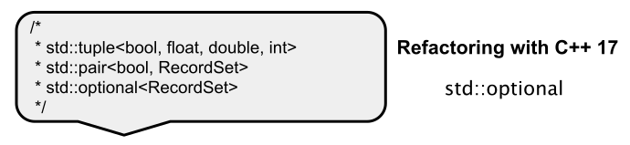

# Klasse `std::optional`

[Zurück](../../Readme.md)

---

[Quellcode](Optional.cpp)

---

## Inhalt

  * [Allgemeines](#link1)
  * [Neue monadische Funktionen](#link2)
  * [Unterschied zwischen `and_then` und `transform`](#link3)
  * [Literaturhinweise](#link4)

---

## Allgemeines <a name="link1"></a>



Siehe das Beispiel im korrespondierenden Quellcode.

---

## Neue monadische Funktionen <a name="link2"></a>

Ab C++ 23 wurden zur Klasse `std::optional` neue Operationen hinzugefügt: `and_then`, `or_else` und `transform`.

Diese Operationen, die von Konzepten der funktionalen Programmierung inspiriert sind,
bieten eine prägnantere und ausdrucksstärkere Möglichkeit,
mit optionalen Werten &ndash; also mit `std::optional`-Objekten &ndash; zu arbeiten.

Die monadischen Interfaces (eingeführt mit C++ 23) bringen vor allem Eleganz und Sicherheit in den Code. Hier sind die wichtigsten Vorteile:

  * Vermeidung von &bdquo;if-Pyramiden&rdquo;:<br />Statt verschachtelter `if (opt.has_value())`-Abfragen kann man Operationen einfach
    mit `.and_then()` oder `.transform()` verketten. Das hält den Code flach und lesbar.
  * Deklarativer Stil:<br />Der Fokus liegt auf dem *Was* (der Logik) statt auf dem *Wie* (dem Error-Handling).
    Der Kontrollfluss für Fehlerfälle ist implizit eingebaut.
  * Sicheres Pipelining:<br />Wenn ein Glied in der Kette `std::nullopt` oder einen Fehler zurückgibt, wird der Rest der Kette automatisch übersprungen.
    Man muss nicht bei jedem Zwischenschritt manuell prüfen.
  * Kompaktheit:<br />Komplexe Transformationen, die früher mehrere Zeilen *Boilerplate*-Code erforderten,
    lassen sich oft in einem einzigen Ausdruck (*Expression*) formulieren.

Kurz gesagt: Monadische Funktionen machen Quellcode funktionaler und weniger fehleranfällig gegenüber vergessenen Null-Checks.

#### Ein Beispiel

*Beispiel*:

```cpp
01: struct User
02: {
03:     std::string name;
04:     std::optional<std::string> email;  // not every user has one
05: };
06: 
07: const std::map<std::size_t, User> database =
08: {
09:     { 1,{ "Sepp", "sepp@gmx.de" } },
10:     { 2,{ "Anton", std::nullopt } },
11:     { 3,{ "Hubert", "hubert@GMAIL.COM" } },
12:     { 4,{ "Franz", "www.franzschneider.com" } }
13: };
14: 
15: std::optional<User> findUser(int id) {
16:     if (auto it = database.find(id); it != database.end()) {
17:         return it->second;
18:     }
19: 
20:     return std::nullopt;
21: }
22: 
23: std::optional<std::string> emailDomain(const std::string& email) {
24:     auto at = email.find('@');
25:     if (at == std::string::npos) {
26:         return std::nullopt;
27:     }
28: 
29:     return email.substr(at + 1);
30: }
31: 
32: std::string toLower(std::string s) {
33: 
34:     std::transform(
35:         s.begin(),
36:         s.end(),
37:         s.begin(),
38:         [](unsigned char c) { return std::tolower(c); }
39:     );
40:     return s;
41: }
42: 
43: std::optional<std::string> domainOf(int id) {
44:     return findUser(id)                                         // -> optional<User>
45:         .and_then([](const User& u) { return u.email; })        // -> optional<string>
46:         .and_then(emailDomain)                                  // -> optional<string>
47:         .transform(toLower);                                    // string -> string, re-wrapped
48: }
49: 
50: void test_04_optional_monadic()
51: {
52:     for (int id : { 0, 1, 2, 3, 4, 5 }) {
53:         auto domain = domainOf(id).or_else([] {
54:             // std::println("  >>> no valid domain found");
55:             return std::optional<std::string>{};
56:             }
57:         );
58:         std::println("{}: {}", id, domain.value_or("<none>"));
59:     }
60: }
```

*Ausgabe*:

```
0: <none>
1: gmx.de
2: <none>
3: gmail.com
4: <none>
5: <none>
```

*Bemerkung*:<br />
`value_or` zählt nicht in die Kategorie der `and_then`, `transform` oder `or_else` Schritte.
Es handelt sich um eine gewöhnliche `std::optional`-Member-Methode, die genau einmal ausgeführt wird &ndash;
nämlich an dem Punkt, an dem die Kette endet &ndash;, wobei sie den Zustand des `std::optional`-Objekts
zu diesem Zeitpunkt überprüft:

  * Ist ein Wert vorhanden, gibt `value_or` eine Kopie dieses Werts zurück; der Ersatzwert (*Fallback*) wird dabei ignoriert.
  * Ist das `std::optional`-Objekt leer, wird der übergebene Ersatzwert zurückgegeben.

---

## Unterschied zwischen `and_then` und `transform` <a name="link3"></a>

`and_then(f)`:<br />`f` Nimmt den enthaltenen Wert entgegen und gibt selbst ein Optional zurück. Wird verwendet, wenn der Schritt fehlschlagen kann. Ist das Optional leer, wird f nicht aufgerufen und der leere Zustand wird weitergegeben.

`transform(f)`:<br />`f` Nimmt den Wert entgegen und gibt einen einfachen Wert zurück, den `transform` wiederum in ein Optional einbettet. Wird verwendet, wenn der Schritt nicht fehlschlagen kann!

  * `and_then()`: Verketten von Operationen, die bereits ein Optional zurückgeben:<br />
  &nbsp;&nbsp;&nbsp;&nbsp;`std::optional<T> -> (T -> optional<U>) -> std::optional<U>`

  * `transform()`: Bildet einen Wert auf einen anderen Wert ab:<br />
  &nbsp;&nbsp;&nbsp;&nbsp;`std::optional<T> -> (T -> U) -> std::optional<U>`

---

## Literaturhinweise <a name="link4"></a>

Die Anregungen zu diesem Code-Snippet finden sich unter anderem unter

[std::optional](https://sodocumentation.net/cplusplus/topic/2423/std--optional)<br>(abgerufen am 23.05.2020).

[Modern C++ Features – std::optional](https://arne-mertz.de/2018/06/modern-c-features-stdoptional/)<br>(abgerufen am 23.05.2020).

[Quick tip: How to return std::optional from a function](https://techoverflow.net/2019/06/13/quick-tip-how-to-return-stdoptional-from-a-function/)<br>(abgerufen am 23.05.2020).

Zu den Erweiterungen ab C++ 23 &ndash; neue monadische Funktionen &ndash; gibt es die folgenden beiden interessanten Artikel:

[How to Use Monadic Operations for `std::optional` in C++ 23](https://www.cppstories.com/2023/monadic-optional-ops-cpp23/)<br>(abgerufen am 08.04.2026).

[Daily bit(e) of C++ | Monadic interface for `std::optional`](https://medium.com/@simontoth/daily-bit-e-of-c-monadic-interface-for-std-optional-fd1a9349960c)<br>(abgerufen am 08.04.2026).

---

[Zurück](../../Readme.md)

---
